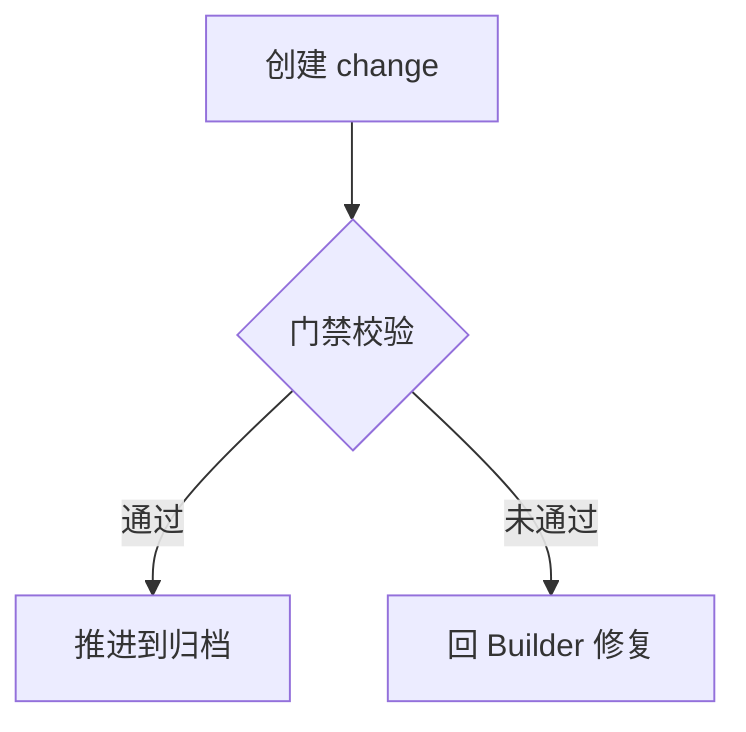

# keel-selftest 演示产品 — 产品需求文档（全局）

> 本文件是应然文档：只写产品应该是什么样，不写实现进度、不挂状态。

范围形态：首建

## 目录

- 一 产品定位 / 二 目标用户与角色 / 三 核心场景 / 四 产品形态与入口 / 五 功能架构 / 六 范围与处置 / 七 页面结构全景 / 八 非功能需求 / 九 术语表 / 十 风险与依赖 / 十一 修订记录

---

## 零、待决策登记

| # | 议题 | 现状取证（参考基线） | 建议默认值 | 影响面 | 决策人 |
|---|---|---|---|---|---|

---

## 一、产品定位

- **是什么**：一个用于验证 keel 治理工作流的最小演示项目。
- **为什么做**：在真实 comet Native 链路上端到端检验治理门禁的拦截与放行行为。
- **一句话价值**：让 keel 开发者有一个可随时重建的验证现场。

## 二、目标用户与角色

| 角色 | 身份 | 核心目标 | 使用场景 | 使用频次 |
|---|---|---|---|---|
| keel 开发者 | 工作流作者 | 验证门禁行为 | 本地终端跑流程 | 按需 |

## 三、核心场景

### 场景 1：流程自验

## 四、产品形态与入口

| 项 | 内容 |
|---|---|
| 平台形态 | 本地命令行项目 |
| 主要入口 | 终端命令 |
| 导航骨架 | 无界面导航 |

## 五、功能架构

| 域 slug | 中文名 | 一句话职责 | 域级文件 |
|---|---|---|---|

本产品无域级拆分：全部能力归全局范围，无域间关系。

## 六、范围与处置

### 6.1 功能范围

| 功能 / 能力 | 所属域 | 一句话说明 |
|---|---|---|
| 流程推进验证 | 全局 | 跑通开户到归档的治理链路 |
| 门禁行为验证 | 全局 | 实证治理校验器红绿两种结果 |

### 6.3 不做清单

| 明确不做的事 | 原因 |
|---|---|
| 多子任务编排验证 | 属后续任务范围 |
| 界面与交互 | 本产品无界面 |

### 6.4 迁移性需求

| 编号 | 内容 | owner | 结束条件 |
|---|---|---|---|

## 七、页面结构全景

### 7.1 导航层级

| 导航层级 | 页面名称 | 页面定位 | 入口 | 主要承载功能 |
|---|---|---|---|---|

### 7.2 页面职责

| 页面名称 | 用户目标 | 关键内容/组件 | 空状态 | 异常状态 |
|---|---|---|---|---|

### 7.3 页面 ↔ 域映射

| 页面 | 所属域 | 说明 |
|---|---|---|---|

本产品无页面；命令行输出即全部界面。

## 八、非功能需求

| 维度 | 要求 | 判定方式 |
|---|---|---|
| 性能 | 单次流程推进秒级完成 | 终端计时观测 |
| 安全 | 不写入项目根之外的路径 | 路径检查 |
| 兼容性 | macOS 终端可用 | 实测 |
| 可维护性 | 可随时删除重建 | 重建演练 |

## 九、术语表

| 术语 | 定义 | 备注 |
|---|---|---|

## 十、风险与依赖

| 类型 | 内容 | 影响 | 应对 |
|---|---|---|---|
| 风险 | 演示现场与真实项目行为存在差异 | 结论外推受限 | 结论只用于 keel 自身验证 |
| 外部依赖 | comet 与 atlas 本地源码 | 版本漂移 | 固定版本复测 |

## 十一、修订记录

| 版本 | 日期 | 修订人 | 变更说明 |
|---|---|---|---|
| 0.1.0 | 2026-10-23 | keel 开发者 | 初稿 |
